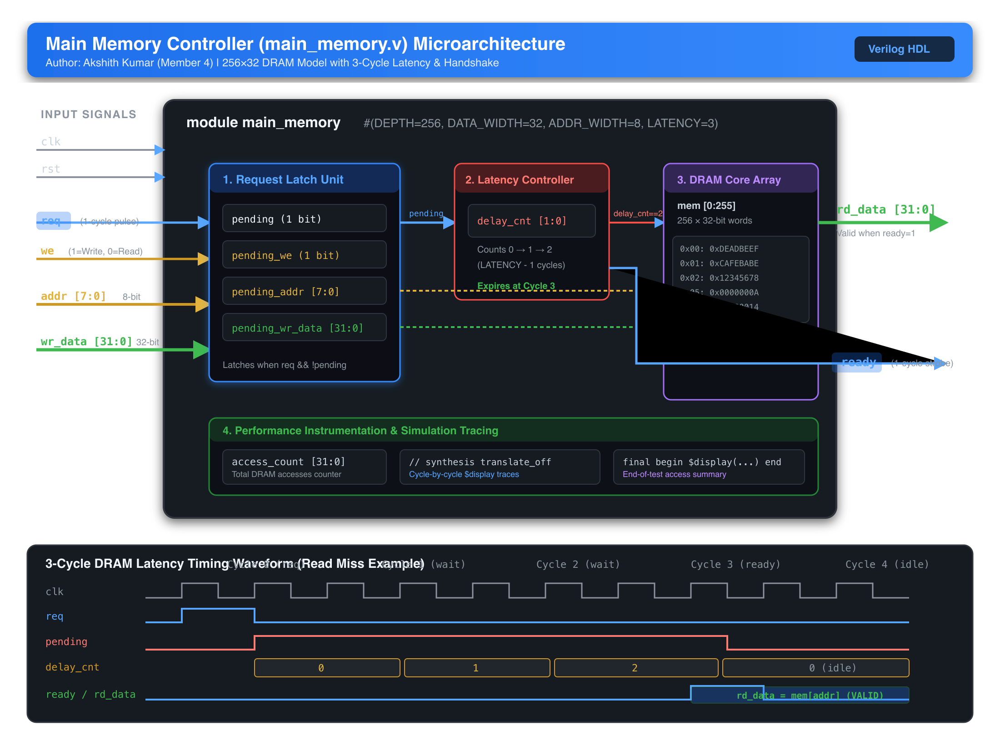
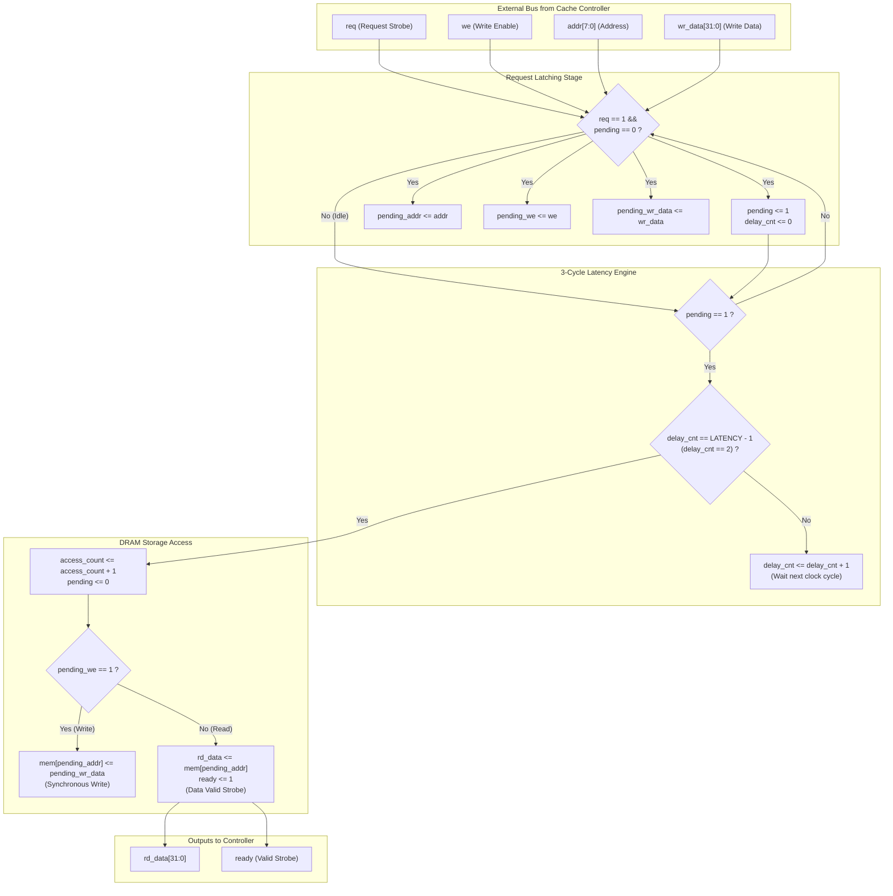
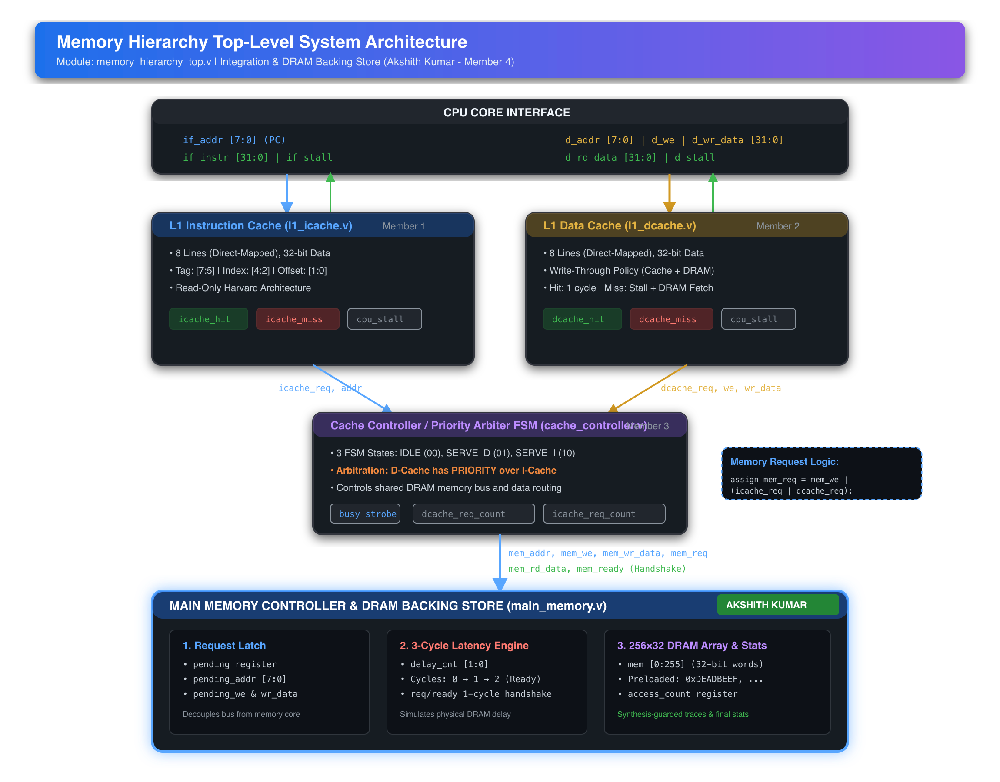
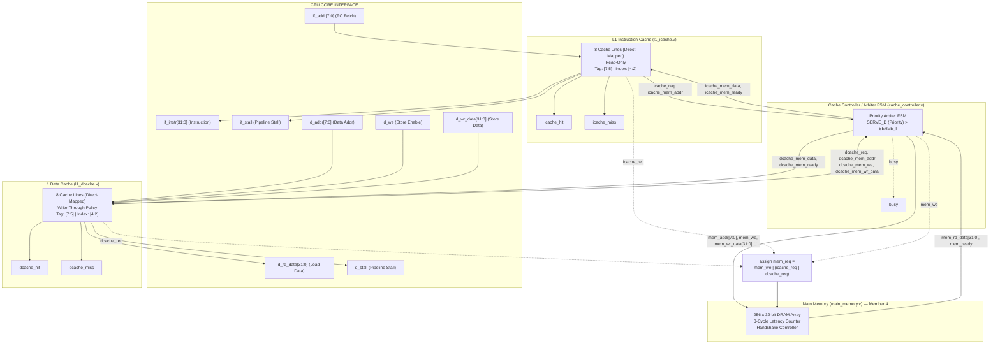

# Main Memory & Top-Level Integration Architecture
**Author:** Akshith Kumar (Member 4)  
**Modules:** `src/main_memory.v` & `src/memory_hierarchy_top.v`  
**Project:** Instruction and Data Memory Hierarchy (MCA Project)

---

## 1. Main Memory Controller (`main_memory.v`) Microarchitecture

The Main Memory module acts as the realistic DRAM backing store for the memory hierarchy. Because physical DRAM takes multiple clock cycles to charge lines and sense data, this module models a **3-cycle latency pipeline** with a strict **request/ready handshake**.

### 1.1 Microarchitecture Image


### 1.2 Detailed Block Diagram

```
                              ┌────────────────────────────────────────────────────────────┐
                              │                 main_memory Module (256x32)                │
                              │                                                            │
    clk ─────────────────────►│                                                            │
    rst ─────────────────────►│                                                            │
                              │                                                            │
    req ─────────────────────►│──┐                                                         │
    we ──────────────────────►│──┼─►┌─────────────────────────┐                            │
    addr[7:0] ───────────────►│──┼─►│   Request Latch Unit    │                            │
    wr_data[31:0] ───────────►│──┘  │  - pending              │                            │
                              │     │  - pending_we           │                            │
                              │     │  - pending_addr[7:0]    │                            │
                              │     │  - pending_wr_data[31:0]│                            │
                              │     └────────────┬────────────┘                            │
                              │                  │                                         │
                              │                  ▼                                         │
                              │     ┌─────────────────────────┐                            │
                              │     │ 3-Cycle Latency Counter │                            │
                              │     │ delay_cnt[1:0] (0 to 2) │                            │
                              │     └────────────┬────────────┘                            │
                              │                  │ (when delay_cnt == LATENCY - 1)         │
                              │                  ▼                                         │
                              │     ┌──────────────────────────────────────────────┐       │
                              │     │               DRAM Storage Core              │       │
                              │     │          256 x 32-bit Memory Array           │       │
                              │     │                                              │       │
                              │     │  Write: mem[pending_addr] <= pending_wr_data │       │
                              │     │  Read : rd_data           <= mem[pending_addr│───────┼──► rd_data[31:0]
                              │     └──────────────────────┬───────────────────────┘       │
                              │                            │                               │
                              │                            ▼                               │
                              │     ┌─────────────────────────┐                            │
                              │     │     Handshake Strobe    │                            │
                              │     │  ready <= 1 (1 cycle)   │────────────────────────────┼──► ready
                              │     └─────────────────────────┘                            │
                              │                            │                               │
                              │                            ▼                               │
                              │     ┌──────────────────────────────────────────────┐       │
                              │     │         Performance / Instrumentation        │       │
                              │     │  - access_count <= access_count + 1          │       │
                              │     │  - synthesis-guarded simulation $display     │       │
                              │     │  - final simulation summary block            │       │
                              │     └──────────────────────────────────────────────┘       │
                              └────────────────────────────────────────────────────────────┘
```

---

### 1.2 Mermaid Microarchitecture Flowchart



---

### 1.3 Latency & Handshake Timing Waveform

#### Read Operation Timing (3-Cycle Latency):
```text
Clock Cycle:      C0        C1        C2        C3        C4
                 ___       ___       ___       ___       ___
clk          ___/   \_____/   \_____/   \_____/   \_____/   \___

req          ___/¯¯¯\___________________________________________  (Pulses high for 1 cycle)
addr         ===< 0x05 >========================================
we           ___________________________________________________  (0 for Read)

pending      _______/¯¯¯¯¯¯¯¯¯¯¯¯¯¯¯¯¯¯¯¯¯¯¯¯¯\_________________  (Asserted for 3 cycles)
delay_cnt    ===< 0x0 >====< 0x1 >====< 0x2 >====< 0x0 >========  (Counts: 0 -> 1 -> 2)

rd_data      =================================< 0x0A >==========  (Data ready at C3)
ready        _________________________________/¯¯¯¯¯\___________  (Pulses high for 1 cycle)
```

#### Write-Through Operation Timing:
```text
Clock Cycle:      C0        C1        C2        C3        C4
                 ___       ___       ___       ___       ___
clk          ___/   \_____/   \_____/   \_____/   \_____/   \___

req          ___/¯¯¯\___________________________________________
addr         ===< 0x02 >========================================
we           ___/¯¯¯¯¯¯¯¯¯¯¯¯¯¯¯¯¯¯¯¯¯¯¯¯¯¯¯¯¯\_________________  (1 for Write)
wr_data      ===< 0xBEEFCAFE >==================================

pending      _______/¯¯¯¯¯¯¯¯¯¯¯¯¯¯¯¯¯¯¯¯¯¯¯¯¯\_________________
delay_cnt    ===< 0x0 >====< 0x1 >====< 0x2 >====< 0x0 >========

mem[0x02]    ===< old >=======================< 0xBEEFCAFE >====  (Written at C3)
ready        ___________________________________________________  (Writes acknowledge to cache)
```

---

## 2. Top-Level Integration (`memory_hierarchy_top.v`) Architecture

The Top-Level module connects the entire memory subsystem together and interfaces directly to the CPU.

### 2.1 System Architecture Image


### 2.2 System Interconnect Diagram



---

## 3. Summary of Design Choices

1. **Parameterization:**  
   `DEPTH=256`, `DATA_WIDTH=32`, `ADDR_WIDTH=8`, and `LATENCY=3` are parameterized so memory depth or latency can be scaled without touching module internals.
2. **Glitch-Free Bus Latching:**  
   The `pending_*` registers prevent bus transitions on the shared memory bus from corrupting an active multi-cycle DRAM access.
3. **Simulation Observability:**  
   `access_count` and `$display` traces provide instant feedback in ModelSim/Icarus Verilog without impacting FPGA synthesis due to `// synthesis translate_off`.
4. **Coherent Memory Request Routing:**  
   The continuous assignment `assign mem_req = mem_we | (icache_req | dcache_req);` ensures the DRAM controller begins counting latency as soon as either cache misses or issues a write-through store.
